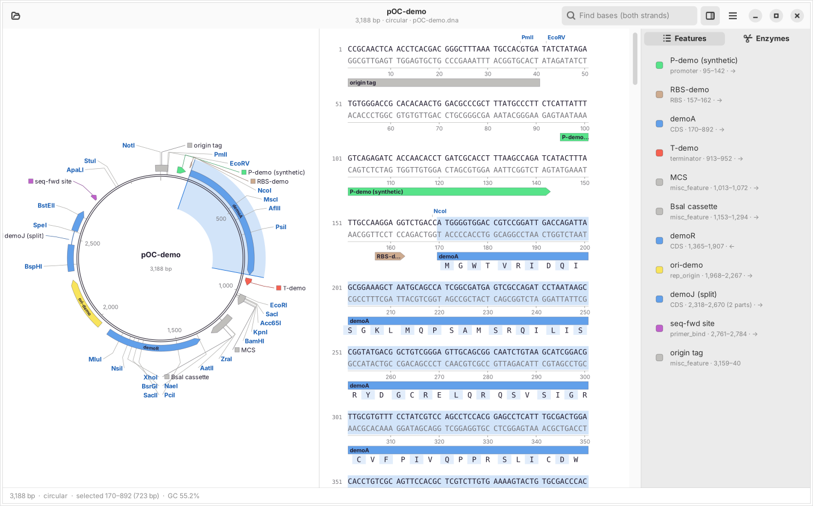

# OpenClone

An open-source, native desktop plasmid viewer for Linux and macOS. It opens
GenBank, FASTA and SnapGene `.dna` files and shows a circular (or linear) map with
features and restriction sites, next to a double-strand sequence view with
translations.

*OpenClone is a working name. It isn't affiliated with any commercial product.*

- **Linux:** GTK4 + libadwaita, drawn with cairo/Pango.
- **macOS:** Swift + AppKit, drawn with CoreGraphics.
- **Shared:** a plain C++17 core (no GUI toolkit) and a shared layout layer, so the
  map and sequence view look and behave the same on both systems.

No Electron, no web stack, no Qt.



## Layout

```
src/core/     openclone_core  sequence model, GenBank/FASTA/.dna readers, enzymes, Tm, I/O (C++17, std only)
src/view/     openclone_view  map + sequence-view layout, hit testing, Document model (C++17, std only)
              cairo_render.*  draws layouts with cairo/Pango (Linux app, PNG/SVG/PDF export)
src/capi/     openclone_capi  C API over core + view, used by the Swift app
src/gtk/      OpenClone for Linux (GTK4 + libadwaita)
macos/        OpenClone for macOS (Swift + AppKit), built via Package.swift
tests/        core_tests, view_tests, capi_tests (CTest)
samples/      synthetic demo plasmid (.gb + .dna) from scripts/make_demo_plasmid.py
packaging/    .desktop file, MIME types, AppStream metainfo, icon, macOS Info.plist
```

## Building on Linux (Fedora)

Fedora is the main Linux target.

```sh
sudo dnf install gcc-c++ cmake ninja-build pkgconfig gtk4-devel libadwaita-devel cairo-devel pango-devel
cmake -S . -B build -G Ninja -DCMAKE_BUILD_TYPE=Release
cmake --build build
ctest --test-dir build --output-on-failure
./build/src/gtk/openclone samples/pOC-demo.dna
sudo cmake --install build      # binary, .desktop file, MIME types, icon, metainfo
```

To build an RPM, use `packaging/fedora/openclone.spec`:

```sh
sudo dnf install rpm-build rpmdevtools desktop-file-utils libappstream-glib
rpmdev-setuptree
git archive --prefix=openclone-0.1.0/ -o ~/rpmbuild/SOURCES/openclone-0.1.0.tar.gz HEAD
rpmbuild -ba packaging/fedora/openclone.spec
sudo dnf install ~/rpmbuild/RPMS/*/openclone-0.1.0-*.rpm
```

You need GTK ≥ 4.12 and libadwaita ≥ 1.5 (Fedora 40 or newer). Other distributions
work too. On Debian/Ubuntu 24.04+ install `build-essential cmake ninja-build
pkg-config libgtk-4-dev libadwaita-1-dev libcairo2-dev` instead.

CI (`.github/workflows/ci.yml`) builds and tests on Fedora, produces the RPM, and
builds the macOS app on a macOS runner.

## Building on macOS

```sh
xcode-select --install                 # or a full Xcode, 15 or newer
scripts/build_macos_app.sh             # -> build/macos/OpenClone.app
open build/macos/OpenClone.app
```

You can also open `Package.swift` in Xcode, or run `swift build`. The C++ core and
its tests still build with CMake on macOS:

```sh
brew install cmake ninja
cmake -S . -B build -G Ninja -DOPENCLONE_FRONTEND=none && cmake --build build
ctest --test-dir build
```

## Headless checks

```sh
# Map image without a display (.png, .svg or .pdf). Linux:
./build/src/gtk/openclone --render-map map.png --enzymes all samples/pOC-demo.dna
# Window screenshot (needs a display; Xvfb works, from xorg-x11-server-Xvfb on Fedora):
xvfb-run -a env GSK_RENDERER=cairo ./build/src/gtk/openclone \
    --screenshot window.png --size 1440x900 --select 170-892 samples/pOC-demo.dna
# macOS map image:
build/macos/OpenClone.app/Contents/MacOS/OpenClone --render-map map.png samples/pOC-demo.dna
```

Options: `--size WxH`, `--enzymes 1|2|3|all` (cutter filter), `--select A-B`
(1-based), `--dark`.

## What works in this milestone

- Open GenBank, FASTA and SnapGene `.dna` files (drag and drop, command line, Finder or
  the file manager). One window per document.
- Circular map with feature arrows in lanes, names along the arc (or as callouts when
  they don't fit), enzyme labels in spread-out columns with leader lines, a tick ring,
  and a selection wedge. Linear map for linear sequences.
- Sequence view: wrapped in multiples of 10 bp, enzyme labels, top and complement
  strands, ruler, feature lanes, and amino acids under CDS features (honors
  `/codon_start`). Shows the cut marker for the active enzyme site.
- Selection by click, drag or shift-click, kept in sync between the map and the
  sequence. Status bar shows length, topology, selection, GC% and Tm for 8–100 bp.
- Features and Enzymes sidebar: per-enzyme show/hide, cut counts, and a unique / ≤2 /
  ≤3 / all cutters filter.
- Find on both strands (IUPAC codes allowed). Copy and Copy Reverse Complement.
- Save As GenBank, Export FASTA, Export Map (PNG/SVG/PDF on Linux, PNG/PDF on macOS).

## Editing (milestone 2, Linux app; the Mac app gets it next)

- Type bases, paste, cut, Backspace and Delete in the sequence view. Features grow,
  shift or shrink with the edits; primers move with them.
- Undo and redo (typing joins one step). The title shows unsaved changes, and closing
  asks to save them.
- Save (Ctrl+S) and Save As by extension: `.dna`, `.gb` or `.fasta`.
- Reverse complement the whole sequence, set the origin, switch circular/linear, and
  start a new sequence from pasted text (Ctrl+N).
- Add, edit and delete features (Ctrl+K adds one from the selection). Add and delete
  primers; primers are drawn on the sequence and the map.
- Copy and paste keep the features and primers inside the copied bases.
- Enzymes that cut on both sides of their site (BaeI, BcgI, BsaXI, CspCI).
- Digest and Gel (Ctrl+D, a first piece of milestone 3): pick enzymes and see the
  fragments with their ends and overhangs, next to a virtual gel with a ladder and
  the uncut plasmid.
- PCR Product: pick a forward and a reverse primer; the product (with 5′ tails and the
  features it covers) opens in a new window. The Primers tab flags primer problems
  (GC, Tm, 3′ clamp, runs, hairpins, dimers).
- Restriction Cloning: cut the vector with one or two enzymes, take an insert from any
  open window, check that the ends ligate in the chosen orientation and open the
  product (vector numbering kept).
- Golden Gate Assembly: pick a Type IIS enzyme and the parts from open windows; the order
  and orientation come from the overhangs, and the dropout is replaced.
- Gibson Assembly (also HiFi and In-Fusion): open the vector with one or two enzymes and
  join linear fragments from open windows by their end overlaps.
- Design Primers for Selection: a primer pair that amplifies exactly the selection, sized
  for a target Tm and checked for dimers and hairpins; adds both primers in one undo step.
- The C API exposes the editing for the Mac app; digest, PCR, cloning and the assemblies are not in it yet.

## Next steps

See [docs/PARITY.md](docs/PARITY.md) for the full checklist. Next up: the Mac editing UI,
then the rest of milestone 3 (enzyme choice by criteria, primers with a search window).

## Credits and ground rules

- Restriction enzyme data comes from **REBASE** (https://rebase.neb.com); see
  [docs/REBASE.md](docs/REBASE.md).
- Melting temperatures use the SantaLucia (1998) unified nearest-neighbor parameters.
- The `.dna` reader is a clean-room implementation of the publicly documented packet
  format. No proprietary code, artwork, colors, help text or feature databases are
  used. The colors are our own, based on the GNOME palette.
- `samples/` holds only **synthetic** sequences generated by
  `scripts/make_demo_plasmid.py`. They are not real plasmids.

## License

GPL-3.0-or-later (see the SPDX headers).
